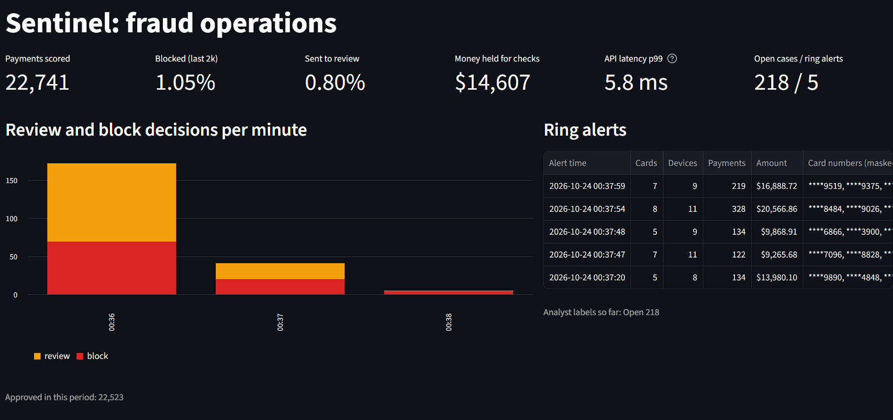
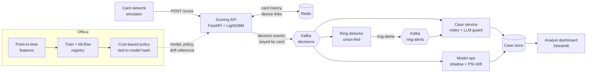
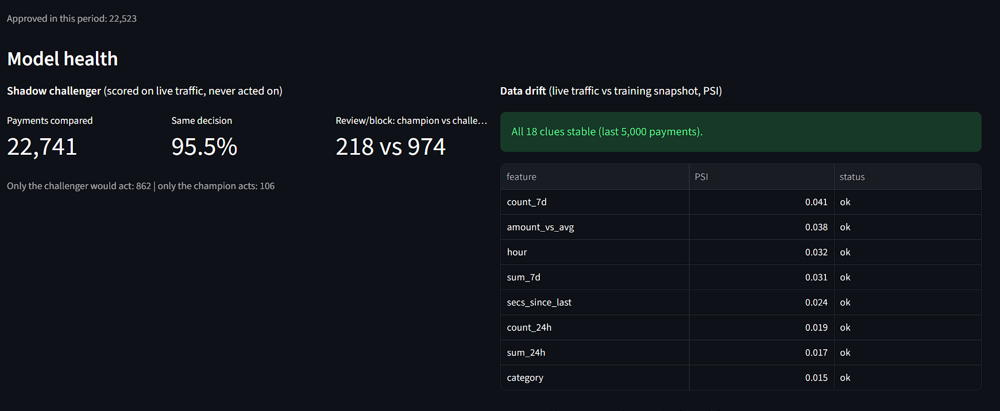

# Sentinel

Real-time card fraud detection: streaming card features, cost-based approve/review/block
decisions, fraud-ring detection on the card-device graph, analyst case notes, and live model
monitoring (shadow challenger + drift).

[](https://github.com/DurgaPrasadVIT/Sentinel_fraud_detection/actions/workflows/ci.yml)




## Results

**Offline, held-out test period** (2020-06-21 to 2020-12-31, 555,719 payments, 2,145 fraud;
trained on the 18 months before it):

| | |
|---|---|
| PR-AUC | **0.969** (amount-only baseline: 0.137) |
| Fraud dollars blocked or sent to review | **98.8%** of $1.13M |
| Good customers blocked | **35** in 6 months (block rate 0.33%) |
| Analyst reviews | **~5 per day** (team capacity: 50) |
| Total cost (missed fraud + $20 per false block + $3 per review) | **$17,043** |

**Live, full stack in Docker on a laptop** (simulator replaying the test period):

| | |
|---|---|
| Scoring latency, client round trip | p50 3.9 ms, **p99 8.4 ms** at 50 req/s |
| Load test, real Redis | **900 req/s**, p99 30 ms, 0 failures ([details](docs/PERFORMANCE.md)) |
| Fraud rings (5 injected) | **5/5 found**, 35/35 ring cards, **0 innocent cards** |
| Drift monitor | 0 alerts on normal traffic, 6 under injected drift |

## Architecture



The shop waits only for the API (validate, read card history from Redis, score, apply policy).
Everything slower (notes, graph, monitoring) reads the decision stream from Kafka, so it can
fail or lag without touching payments. Full reasoning and trade-offs: [docs/DESIGN.md](docs/DESIGN.md).

## Highlights

- **No leakage, no skew.** Features only use earlier payments (sliding windows per card), split
  by time. The online Redis path (one atomic Lua script per payment) matches the training
  features on 50,000 real payments with 0 mismatches; a parity test keeps it that way.
- **Decisions in money, not thresholds.** Review/block lines are chosen to minimise cost under
  the review team's capacity, saved with the model's fingerprint; the API refuses to start with
  a policy chosen for a different model.
- **Explanations.** Per-payment SHAP reasons on a NumPy fast path (identical to the pandas path,
  10x faster).
- **Fraud rings.** Union-find over the card-device graph finds money-mule rings that look normal
  one payment at a time (the model alone stopped 4 of 105 ring payments).
- **Case notes with a hallucination guard.** Pluggable writers (template, Ollama, Anthropic,
  OpenAI). Every number, time, date and name in an LLM note is checked against the facts; on any
  mismatch the template note is used. Masked card numbers only; personal attributes never appear
  in notes.
- **Model ops.** MLflow tracking and registry, an Isolation Forest challenger scored in shadow
  mode, PSI drift per feature and on the score itself.
- **Production bugs found and fixed**, each written up with the evidence: a 40 ms delayed-ACK
  stall with multi-worker uvicorn, float residue causing false drift alarms, a split consumer
  group hiding fraud rings ([design doc](docs/DESIGN.md#6-incidents)).



## Quick start

Needs Python 3.11, Docker, and the
[Credit Card Transactions Fraud Detection dataset](https://www.kaggle.com/datasets/kartik2112/fraud-detection)
(`fraudTrain.csv`, `fraudTest.csv` in `data/raw/`).

```bash
python -m venv .venv && source .venv/bin/activate      # Windows: .venv\Scripts\activate
pip install -r requirements-dev.txt && pip install -e . --no-deps

# Offline: clean data, build features, train, choose the policy, train the challenger
python -m sentinel.data
python -m sentinel.features
python -m sentinel.train
python -m sentinel.decisions
python -m sentinel.challenger

# Online: API, Redis, Kafka, case service, ring detector, model ops, dashboard
docker compose --profile app up -d --build
docker compose --profile demo run --rm simulator       # one week of history, then 3,000 live payments
```

Dashboard: http://localhost:8501 &nbsp;|&nbsp; API docs: http://localhost:8000/docs &nbsp;|&nbsp;
Experiments: `mlflow ui --backend-store-uri sqlite:///mlflow.db`

```bash
curl -s localhost:8000/score -H 'Content-Type: application/json' -d '{
  "device_id": "a1b2c3d4e5f6", "card_id": 4242, "ts": "2020-12-21T21:00:00",
  "amount": 25.0, "category": "gas_transport", "age": 35, "city_pop": 50000,
  "cust_lat": 40.72, "cust_lon": -74.04, "merch_lat": 40.75, "merch_lon": -74.0}'
# {"txn_id":"8062ca4c...","score":0.0,"decision":"approve","reasons":[],"latency_ms":3.55}
```

Replay shifted traffic to see the drift alerts: add `python -m sentinel.simulator --url http://api:8000/score --drift`
to the simulator command.

## Repository

| Path | What |
|---|---|
| `src/sentinel/data.py`, `features.py`, `window.py` | cleaning (PII dropped), point-in-time card features |
| `train.py`, `decisions.py`, `explain.py`, `tracking.py` | LightGBM training, cost-based policy, SHAP, MLflow |
| `api.py`, `scoring.py`, `store.py`, `events.py` | scoring API, fast path, Redis card/device state, Kafka publisher |
| `rings.py` | fraud-ring detection (union-find) |
| `casenotes.py`, `cases.py`, `dashboard.py` | case notes + guard, case service, analyst dashboard |
| `challenger.py`, `drift.py`, `modelops.py` | challenger, PSI drift, shadow scoring service |
| `simulator.py`, `probe.py`, `loadtest/` | traffic replay with injected attacks, latency probe, Locust |
| `tests/` | 126 tests: parity, policy, guard, graph, migrations, services |

## Testing

```bash
ruff check src tests
pytest
```
CI runs lint and tests on every pull request, builds the image and smoke-tests it as a non-root
user on a fresh volume. The dataset and trained model aren't in git; tests that need them use a
small generated model or are skipped.

## Limitations

- **Synthetic data.** The dataset is generated (Sparkov): cards have no personal habits and no
  devices. Devices, households and rings are injected by the simulator, so ring results show the
  mechanism works, not real-world precision. See the [model card](docs/MODEL_CARD.md).
- **Labels arrive instantly** in this setup. In production they come weeks later (chargebacks),
  which delays evaluation and retraining.
- **Single-node components** for the demo: SQLite case store, the ring graph in one process.
  What changes at scale is in the design doc.

## Docs

- [Design](docs/DESIGN.md): requirements, architecture, decisions and trade-offs, incidents, scaling
- [Model card](docs/MODEL_CARD.md): data, metrics, decision policy, fairness, monitoring
- [Performance](docs/PERFORMANCE.md): profiling, load tests, latency investigation
